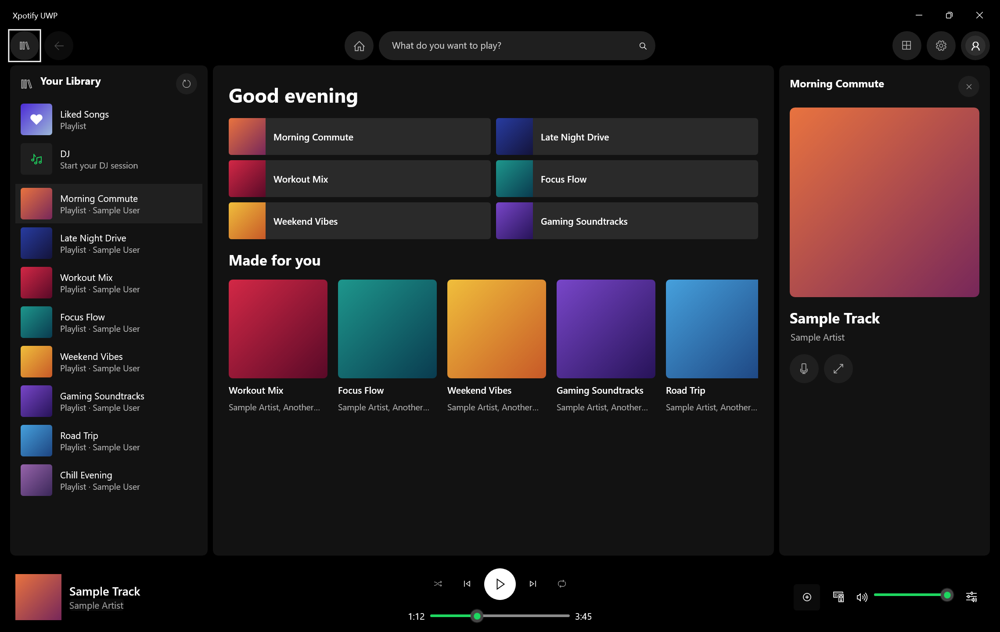

# Xpotify UWP

**Spotify on Xbox in Developer Mode, with music that keeps playing in the background.**

(all builds since 11/5/2026)

Xpotify UWP is an unofficial Spotify client for Xbox Series X|S in Developer Mode, where the
retail Spotify app isn't available. Start a song, go back to the dashboard or open another
app or homebrew, and the music keeps playing.

_The Xpotify layout, shown in a PC window with sample data._

**[Download the latest release](https://github.com/PrismFox67/Xpotify-UWP/releases/latest)**

> **All credit for the application itself goes to [megabytesme](https://github.com/megabytesme).**
> They built [LibreSpotUWP](https://github.com/megabytesme/LibreSpotUWP): the entire Spotify
> client, and the UWP-safe native build of
> [librespot](https://github.com/librespot-org/librespot) that makes playback possible.
> Please go star [their repository](https://github.com/megabytesme/LibreSpotUWP).
>
> Xpotify UWP is a fork of **Spotbox**
> ([maayan080/LibreSpotUWP-XBOX-edition](https://github.com/maayan080/LibreSpotUWP-XBOX-edition)),
> which ported LibreSpotUWP to Xbox in Developer Mode.

|  | **Note:** This **fork** was made with the use of AI. Read more about the rating [here](https://www.realgoodai.org/real-rating). |
| :---: | :--- |

**Disclaimer:** This is an unofficial, third-party Spotify client. It is not affiliated with,
endorsed or sponsored by Spotify AB or Microsoft. It uses a reverse-engineered protocol,
which is against Spotify's terms of service, so use it at your own risk.

## Features

- **Background playback.** Music keeps playing on the dashboard and while you use other apps
  and homebrew. Confirmed across several songs on an Xbox Series X.
- **Spotify-style layout.** A top bar with search, Your Library on the left and a Now Playing
  panel on the right, sized for a TV. The original LibreSpotUWP layout is still available
  under Settings > Appearance.
- **Sign-in with a controller.** One **Sign in with Spotify** button opens Spotify's sign-in
  page inside the app. No second device or helper app is needed.
- **Spotify Connect.** Pick the Xbox from the Spotify app on your phone and control it from
  there.
- **Spotify DJ.** From 1.1.8.0, start DJ from the Spotify app on your phone with the Xbox
  selected, and you'll hear the DJ between songs.
- **Streaming quality setting.** 96, 160 or 320 kbps. The default is 320.
- **A clear message when Spotify blocks playback** for your account (see the FAQ), instead
  of a Play button that does nothing.
- **Update notices.** The app tells you when a new full release is out.

Your library, playlists, search and synced lyrics all come from LibreSpotUWP.

## You need

- An Xbox Series X|S in Developer Mode (tested on a Series X only)
- A Spotify Premium account
- A PC on the same network, to install the app through Device Portal

## Install

1. Download the zip from the [latest release](https://github.com/PrismFox67/Xpotify-UWP/releases/latest)
   and unzip it on a PC.
2. On the Xbox, open Dev Home and enable Device Portal.
3. On the PC, open the Device Portal address shown in Dev Home and choose **Add**.
4. Select the `XpotifyUWP_..._x64.msix` file. When asked for dependencies, add every file in
   the `Dependencies` folder.
5. Finish the install. If Dev Home lists Xpotify UWP as a Game, change its type to **App**.
6. Open Xpotify UWP and sign in.

Updating works the same way, and you stay signed in.

## Known issues

- **Some accounts can't play music at all.** See the FAQ below.
- **Background memory is close to the limit.** Usage sat at 96 to 100 MB of the 128 MB the
  Xbox allows in the background during testing, so music could stop after a long session.
- **Music may stop if you go Home soon after signing in.** Reopen the app and start a song
  again.
- The window can be blank for a few seconds when you come back to the app.
- Some playlists have no artwork.

## FAQ

### Can I use Xpotify UWP with a Spotify Free account?
No. Playback uses Spotify features that Free accounts don't have. The app rejects the
sign-in and asks for Spotify Premium.

### I have Premium, but Play does nothing and I can't start a song. Why?
Spotify refuses to send audio keys to some accounts, in every app built on librespot. Newer
accounts seem to be hit most often, but older ones are affected too, and Spotify hasn't said
why. Browsing still works, but music can't play. This is a Spotify-side change with no known
fix. Spotify's web player isn't a workaround on Xbox either, because the console's browser
lacks the Widevine DRM it needs. See
[librespot #1649](https://github.com/librespot-org/librespot/issues/1649).

### How do I sign in?
Open the app and choose **Sign in with Spotify**. Spotify's sign-in page opens inside the
app, followed by a second page that authorizes playback. The LibreSpotUWP Login Helper isn't
needed on Xbox.

### Does it run on a PC?
It does, and each release is tried on a PC first. But the package is signed with a
self-signed certificate that Windows won't accept until you trust it, and the fork is tuned
for a TV. For PCs, phones and other devices, upstream
[LibreSpotUWP](https://github.com/megabytesme/LibreSpotUWP) is the better choice.

### How do I report a bug?
Open an [issue](https://github.com/PrismFox67/Xpotify-UWP/issues) and say what you did, what
you expected and roughly when it happened. Attaching the log helps a lot. In Device Portal,
go to File explorer > LocalAppData > PrismFox67.XpotifyUWP_16s1rqvrsbvgj > TempState and
download `log.txt`. Don't post your password or anything from your Spotify sign-in.

## Building and technical notes

- **[README-XPOTIFY.md](README-XPOTIFY.md)** covers what this fork changes, how background
  playback works on Xbox, and how to build the app.
- **[README-SPOTBOX-FORK.md](README-SPOTBOX-FORK.md)** is Spotbox's own description of the
  Xbox port, kept unchanged.
- The upstream [LibreSpotUWP README](https://github.com/megabytesme/LibreSpotUWP#readme) has
  the build guide for `librespot.dll` and for other devices.

## Credits

- **[megabytesme](https://github.com/megabytesme)** wrote LibreSpotUWP, which is nearly all
  of this application.
- **Spotbox** ([maayan080/LibreSpotUWP-XBOX-edition](https://github.com/maayan080/LibreSpotUWP-XBOX-edition))
  did the Xbox port and the in-app sign-in.
- **[librespot](https://github.com/librespot-org/librespot)** implements the Spotify protocol.

## Licence

**CC BY-NC-SA 4.0**, inherited from upstream: attribution required, non-commercial use only,
and derivatives must share alike. See [LICENSE.md](LICENSE.md).

Spotify is a trademark of Spotify AB. Xbox is a trademark of Microsoft.
